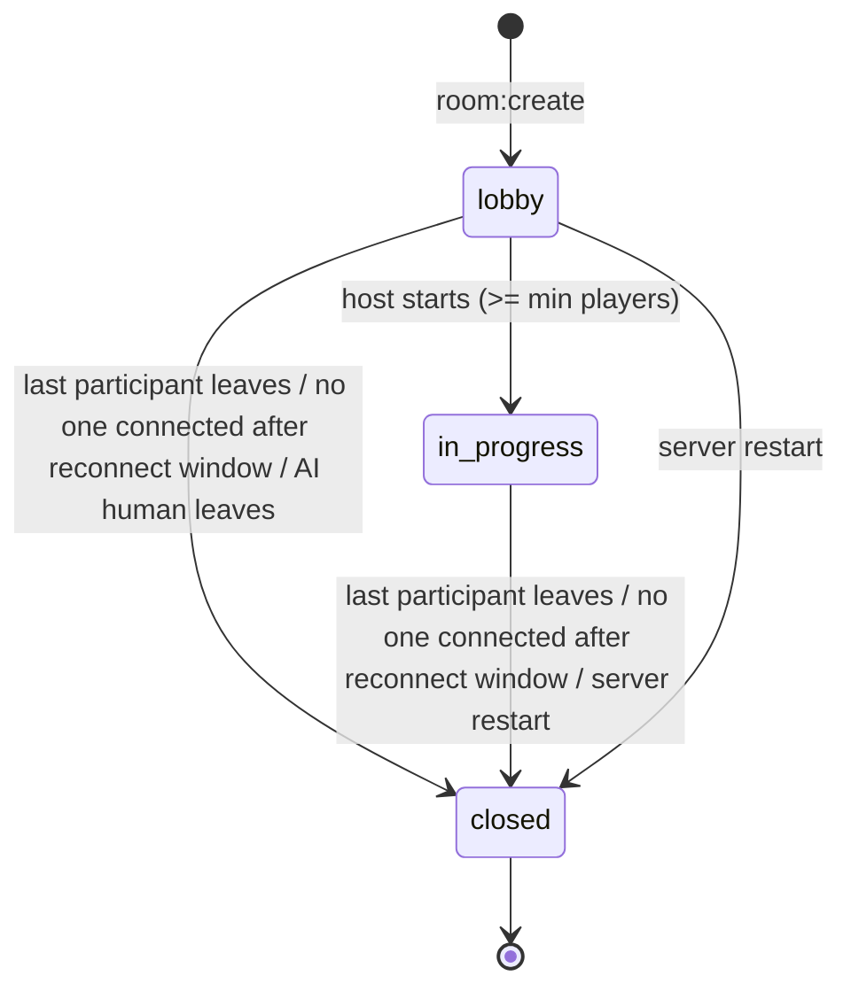
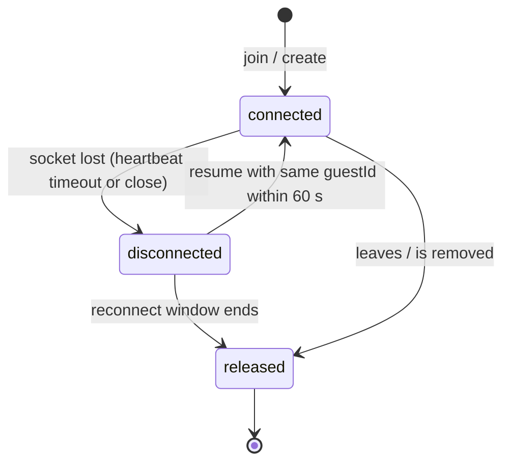

# Phase 1 Data Model: Platform Core, Visual Hub & Room Engine

All room data lives **in server memory** and is discarded when a room closes or the process restarts (see research R4, R5).
The only data stored on a device is the guest profile in the browser's `localStorage`.

Field types are described conceptually; exact TypeScript definitions live in `shared/src/` at implementation time and must
follow [contracts/realtime-events.md](contracts/realtime-events.md).

## Entities

### GameDefinition (static registry, shared by client and server)

| Field | Description / rule |
|-------|--------------------|
| `id` | Stable game identifier, lowercase slug (`ludo`, `snakes-and-ladders`, `housie`, `bingo`). Used in `/room/{gameId}/{roomId}`. |
| `name` | Display name. |
| `status` | `active` or `coming_soon`. Only `active` games can create rooms (FR-004). |
| `minPlayers` / `maxPlayers` | Player limits. Ludo: 2 / 4 (FR-016). |
| `defaultCapacity` | Capacity preselected for new online rooms (Ludo: 4). |
| `supportsAi` | Whether "Play with AI" is offered (Ludo: true). Bot count range is `1 .. maxPlayers - 1`. |
| `seatColors` | Ordered color tags, one per seat (Ludo: red, green, yellow, blue). |
| `theme` | Card accent colors and art key for the Hub. |

### GuestProfile (browser `localStorage`, never trusted by the server beyond validation)

| Field | Description / rule |
|-------|--------------------|
| `guestId` | Random UUID created on first visit. **Private**: sent only to the server to resume a seat; never shown to or sent to other participants. |
| `displayName` | 1 to 20 characters after trimming; control characters stripped; plain text only. Blank gets a generated friendly name (for example "Swift Panda") (FR-006). |
| `avatar` | One of a fixed set of avatar badge keys. |
| `soundOn` | Boolean audio/SFX preference. |

### Room (server memory)

| Field | Description / rule |
|-------|--------------------|
| `roomId` | 8 characters from a 31-character unambiguous alphabet; unique among live rooms; shown as `XXXX-XXXX` (FR-013). |
| `gameId` | References a `GameDefinition` with `status = active`. |
| `mode` | `online` (shareable invite) or `ai` (single human plus bots, no invite) (FR-011, FR-012). |
| `state` | `lobby`, `in_progress`, or `closed` (see state machine below). |
| `capacity` | Number of seats. Within the game's `minPlayers .. maxPlayers`; never below the number of occupied seats (FR-016, FR-020). In `ai` mode it is `1 + botCount`. |
| `seats` | Ordered array of `capacity` Seats. |
| `hostPlayerId` | `playerId` of the one and only host (FR-019). Never null while the room is open. |
| `rev` | Integer incremented on every state change; clients ignore older revisions. |
| `joinCounter` | Monotonic counter used to assign each Participant a `joinSeq`. |
| `chat` | Ring buffer of the last 50 ChatMessages (FR-031). |
| `removed` | Map of hashed `guestId` to `blockedUntil` for players the host removed (FR-019, 60 seconds). |
| `createdAt`, `lastActivityAt` | Timestamps for logging. |
| `emptyTimer` | Timer started when no participant is connected; closes the room when the reconnect window ends (FR-024). |

### Seat (part of Room)

| Field | Description / rule |
|-------|--------------------|
| `index` | 0-based position. |
| `color` | Taken from the game's `seatColors[index]`; unique within the room (assumption). |
| `occupant` | `null` (open) or a Participant. |

### Participant (occupies a Seat)

| Field | Visible to all | Description / rule |
|-------|----------------|--------------------|
| `playerId` | yes | Server-issued public ID, unique in the room. |
| `kind` | yes | `human` or `bot`. Bots are always `connected`, never host. |
| `displayName` | yes | Sanitized; if it duplicates another name in the room, a numeric suffix is added (edge case). |
| `avatar` | yes | Avatar key. |
| `isHost` | yes | True for exactly one participant. Derived from `hostPlayerId`. |
| `connection` | yes | `connected` or `disconnected`. |
| `joinSeq` | yes | Order of joining; the lowest `joinSeq` among connected humans becomes host on handover (FR-021). |
| `guestId` | **no** | Private key for seat reclaim. |
| `socketId` | **no** | Current socket, or null while disconnected. |
| `reconnectTimer` | **no** | 60-second timer started on disconnect (FR-018). |

### ChatMessage

| Field | Description / rule |
|-------|--------------------|
| `id` | Unique, increasing per room. |
| `kind` | `player` or `system`. |
| `playerId` | Sender for `player` messages; absent for `system`. |
| `name`, `color` | Snapshot of the sender's name and color tag at send time, so history stays correct after a seat is released. |
| `text` | Plain text, 1 to 500 characters for player messages; server-generated for system messages. |
| `systemCode` | For `system`: `joined`, `left`, `disconnected`, `reconnected`, `removed`, `host_changed`, `capacity_changed`, `match_started`, `seat_released`. |
| `ts` | Server timestamp (UTC milliseconds); clients format it in local time. |

### InviteLink (derived, not stored)

`/room/{gameId}/{roomId}` appended to the page origin. Only offered when `mode = online` (FR-014).

## Relationships

- `GameDefinition 1 -- * Room` (via `gameId`).
- `Room 1 -- capacity Seat`; `Seat 0..1 -- 1 Participant`.
- `Room 1 -- 1 Participant` as host (`hostPlayerId`); that participant must be a connected or reconnecting human.
- `Room 1 -- 0..50 ChatMessage` (ring buffer).
- `GuestProfile` exists only in the browser; a Participant is created when a GuestProfile joins a Room.

## Validation rules (server-enforced; the UI mirrors them for clarity only)

| Rule | Source |
|------|--------|
| `gameId` must exist and be `active`; otherwise `GAME_UNAVAILABLE`. | FR-004 |
| `displayName` trimmed to 1 to 20 characters, plain text, control characters removed. | FR-006, edge cases |
| `capacity` integer within game limits and `>=` occupied seats. | FR-016, FR-020 |
| `start` allowed only in `lobby`, only by the host, and only when seated players `>= minPlayers` (bots count). | FR-019, FR-020 |
| `kick` and `setCapacity` allowed only by the host while in `lobby`; the host cannot kick themselves. | FR-019 |
| Chat text is trimmed, non-empty, at most 500 characters; rate limit 5-message burst and 1 per second sustained. | FR-029 |
| `join` allowed only when `state = lobby`, a seat is open, the guest is not in the `removed` cooldown, and `mode = online`. A resume by a known `guestId` within the reconnect window is always allowed. | FR-015, FR-018, FR-019 |
| One seat per `guestId` per room; a second tab with the same `guestId` takes over the same seat. | Edge case |
| Total live rooms capped (default 100); creation beyond the cap returns `SERVER_BUSY`. | SC-009, R11 |

## State transitions

### Room

- A room in `in_progress` never returns to `lobby` in this feature (rematch is out of scope).
- `closed` rooms are removed from memory immediately; their link then answers `ROOM_NOT_FOUND`.

### Participant connection

- `released` in a **lobby** reopens the seat for new joiners; in a **match** the seat is released, the match continues, the
  game module is informed, and the departed guest cannot rejoin that match (FR-018).
- If the host is `released`, the connected human with the lowest `joinSeq` becomes host in the same step; if none exists the
  room closes (FR-021).

### Host role

`hostPlayerId` changes only by: (a) room creation, or (b) automatic handover when the host is released. There is no
request, vote, or co-host (FR-019, SC-012). A returning former host rejoins as a regular player (new `playerId`, new
`joinSeq`).

## Derived and ephemeral data

- **Presence list**: the `seats` array projected for clients (never includes `guestId`, `socketId`, or timers).
- **Unread count** (client only): chat messages received while the drawer is collapsed.
- **Connection banner** (client only): `connecting`, `waking`, `reconnecting`, or `connected`, derived from socket state and
  retry attempts (FR-042).
