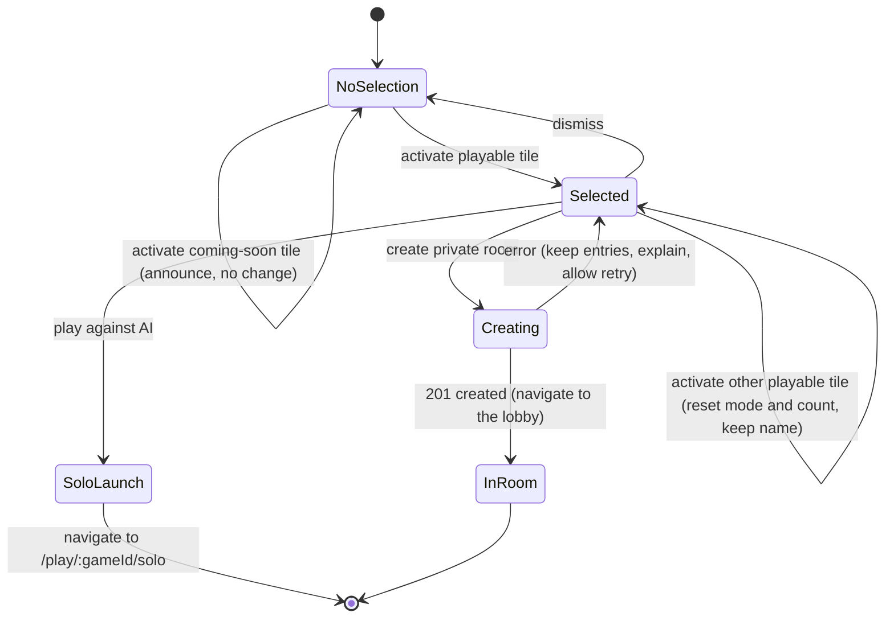

# Data Model: Games Landing Page and Game-First Room Setup

Nothing here is persisted on the server beyond what 001 already holds for a room. Catalog data is
derived at request time; preferences live in the visitor's browser.

## Entities

### CatalogEntry (read model, from `GET /api/catalog`)

| Field | Type | Rules |
|-------|------|-------|
| `id` | string | 1 to 40 chars, lowercase letters, digits and `-`; unique within the catalog |
| `name` | string | 1 to 40 chars |
| `description` | string | 1 to 200 chars, plain text |
| `category` | string | 1 to 30 chars, plain text label |
| `status` | `PLAYABLE` or `COMING_SOON` | `PLAYABLE` only for a registered game |
| `test` | boolean | true only for test games; shown as "Test game" |
| `minParticipants` | integer | 1 to 100 |
| `maxParticipants` | integer | `minParticipants` to 100 |
| `defaultParticipants` | integer | within the room-size range (see Room Setup Choices) |
| `durationMinutes` | `{ min, max }` | 1 to 600, `min <= max` |
| `modes` | list of `SOLO_AI`, `ONLINE` | at least 1 value, no duplicates; `COMING_SOON` entries list intended modes but offer none |
| `art` | `{ icon, palette }` | values from the fixed enums in research R3 |

Source: for `PLAYABLE`, the registered game's `GameDescriptor`; for `COMING_SOON`, the roadmap.
A roadmap id that matches a registered game is dropped.

### GameDescriptor (extended, `packages/game-sdk`)

Existing: `id`, `name`, `minParticipants`, `maxParticipants`, `settingsSchema`.
Added: `description`, `category`, `durationMinutes`, `modes`, `defaultParticipants?`, `art`,
`test?`. The registry rejects a descriptor that breaks the rules above.

### Roadmap entry (static, server)

A `CatalogEntry` without lifecycle, `status = COMING_SOON`. Seeded with Ludo, Snakes & Ladders,
Tambola, Draw & Guess, Royal Chess, Royal Yacht Dice and Four-in-a-Row. Values are placeholders
(spec Assumptions) and carry no commitment.

### Room Setup Choices (request to `POST /api/rooms`)

| Field | Type | Rules |
|-------|------|-------|
| `displayName` | string | existing display name rules (unchanged) |
| `gameId` | string, optional | must be a registered game with mode `ONLINE`; else `GAME_UNAVAILABLE` |
| `maxParticipants` | integer, optional | requires `gameId`; `max(2, game.min) <= n <= min(100, game.max)` |

Derived values:

- **Allowed range** `[lo, hi]` = `[max(2, game.min), min(100, game.max)]`.
- **Default** = `game.defaultParticipants` if present, else `hi`.
- **No `gameId`**: unchanged 001 behavior (no selected game, limit 100).
- **Idempotency fingerprint**: `displayName|gameId|maxParticipants` (empty when absent), scoped to
  the existing `create` scope.

Result: a room with `selectedGameId = gameId`, `settings.maxParticipants = n` and
`settings.gameSettings` equal to the game's schema defaults. The base 001 rule still applies
afterward: the host may change the limit in the lobby but not below the number of seated people.

### Visitor Preferences (browser `localStorage`)

| Key | Value | Rules |
|-----|-------|-------|
| `myarena-name` | string | validated with the display name schema on read; invalid values are dropped |
| `myarena-effects` | `on` or `off` | absent means default: off if reduced motion is requested, else on |
| `myarena-sound` | `on` or `off` | absent means `on`; exposed to games, this feature plays no audio |
| `myarena-last-room` | room id | cleared on leave, or when the session probe reports no seat |
| `myarena-theme` | existing | unchanged |

### Landing Selection (in-memory UI state)

State: `selectedGameId | null`, `mode | null` (`SOLO_AI` or `ONLINE`), `playerCount`, `displayName`,
`submitStatus`.

## State transitions

Rules:

- `NoSelection` shows no create controls, count control or solo action (FR-008, SC-002).
- Entering `Selected` computes the visible modes from the entry's `modes`; a single mode shows a
  note that the other is not available (FR-010).
- `?game=` mirrors `selectedGameId`; an invite route clears it (spec edge case).
- A retry after `Creating` error reuses the same idempotency key while the inputs are unchanged.

## Relationships

- `CatalogEntry.id` equals `GameDescriptor.id` for playable entries, and equals the id of the
  game a room selects. `GET /api/games` entries are a subset (online-capable registered games).
- A room's `selectedGameId` references a registered game; the server rejects any other id.
