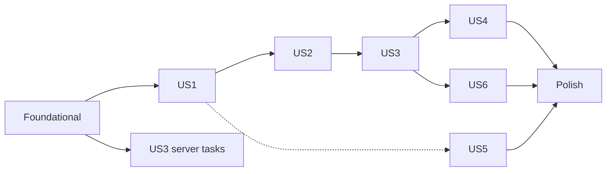

# Tasks: Games Landing Page and Game-First Room Setup

**Input**: Design documents from `/specs/002-games-landing-page/`

**Prerequisites**: [plan.md](plan.md), [spec.md](spec.md), [research.md](research.md), [data-model.md](data-model.md), [contracts/](contracts/), [quickstart.md](quickstart.md)

**Tests**: Included. The constitution requires automated tests for server-authoritative rules and permissions where practicable (Development Quality Gates), and the plan defines the test stack. Real-device acceptance is manual and recorded as evidence (spec FR-030). Within each story, write the test tasks first and confirm they fail before implementing.

**Organization**: Tasks are grouped by user story. Nothing in this list is marked done until evidence exists (Principle IX).

## Format: `[ID] [P?] [Story] Description`

- **[P]**: Can run in parallel (different files, no dependency on an incomplete task)
- **[Story]**: User story the task belongs to (US1 to US6)
- Paths follow the monorepo layout in plan.md: `apps/server`, `apps/web`, `packages/protocol`, `packages/game-sdk`
- Test-game ids: `test-stub` ("Test match", 2 to 100 players, solo and online) and `test-online` ("Test room game", 2 to 6 players, online only). Both are registered only when `TEST_GAME_SECONDS` is set.

---

## Phase 1: Setup

**Purpose**: Configuration keys and a baseline to compare against

- [X] T001 [P] Add the keys `DEPLOY_TARGET` and `TEST_GAME_SECONDS` (names only, no values, not synced) to the web service `envVars` in `render.yaml`
- [X] T002 [P] Record the baseline before any change in `specs/002-games-landing-page/acceptance/baseline.md`: results of `npm run lint`, `npm test`, `npm run test:integration`, `npm run test:contract`, `npm run test:e2e -w @myarena/web -- --project=desktop-chromium`, and the gzipped entry-bundle size (about 138 KB expected)

---

## Phase 2: Foundational (Blocking Prerequisites)

**Purpose**: Catalog contracts, preview guard, design tokens and storage helpers that every story needs

**CRITICAL**: No user story work can begin until this phase is complete

- [X] T003 [P] Create `packages/game-sdk/src/presentation.ts` with `ART_ICONS` = `TARGET | SNAKE | TICKET | PALETTE | CROWN | DICE | DISCS | FLASK`, `ART_PALETTES` = `CRIMSON | EMERALD | AMBER | VIOLET | INDIGO | ROSE | TEAL | SLATE`, `GAME_MODES` = `SOLO_AI | ONLINE`, and their types; export from `packages/game-sdk/src/index.ts`
- [X] T004 Extend `GameDescriptor` in `packages/game-sdk/src/descriptor.ts` with `description` ("1 to 200" chars), `category` ("1 to 30" chars), `durationMinutes` (`{ min, max }`, "1 to 600", `min <= max`), `modes` ("non-empty, unique subset of SOLO_AI | ONLINE"), `defaultParticipants?` ("inside [max(2, min), min(100, max)]"), `art` (`{ icon, palette }`), and `test?` (boolean) (depends on T003)
- [X] T005 [P] Create `packages/protocol/src/catalog.ts` with Zod `catalogEntrySchema` and `catalogResponseSchema` (strict) exactly per `contracts/catalog-and-room-setup.openapi.yaml` `CatalogEntry`: `id` matching `^[a-z0-9-]{1,40}$`, `name` "1 to 40", `description` "1 to 200", `category` "1 to 30", `status` `PLAYABLE | COMING_SOON`, `test` boolean, `minParticipants`/`maxParticipants`/`defaultParticipants` "1 to 100", `durationMinutes` "1 to 600" with `min <= max`, `modes` "at least 1, no duplicates", `art` icon and palette enums; export types and schemas from `packages/protocol/src/index.ts`
- [X] T006 [P] Add the REST problem `GAME_UNAVAILABLE` (plain-language `detail` and `nextStep`; must not collide with the existing realtime rejection of the same name) to `packages/protocol/src/errors.ts` and its status 409 to the `statuses` map in `apps/server/src/http/problem.ts`
- [X] T007 Make `GameRegistry` in `apps/server/src/games/registry.ts` validate the new descriptor fields (unique `id` matching `^[a-z0-9-]{1,40}$`, `1 <= min <= max <= 100`, non-empty modes, default inside range, valid art values), expose `entries()` returning full descriptors, and make `list()` return only games whose `modes` include `ONLINE`, with the same four fields as today (depends on T004)
- [X] T008 [P] Create `apps/server/src/games/roadmap.ts` with the static roadmap as `COMING_SOON` entries in this order, using placeholder values (no commitment): Ludo, Snakes & Ladders, Tambola, Draw & Guess, Royal Chess, Royal Yacht Dice, Four-in-a-Row; each with description, category, player range, duration range, intended modes and art from the fixed enums (depends on T005)
- [X] T009 Create `apps/server/src/games/catalog.ts` with `buildCatalog(registry)`: map registered games to `PLAYABLE` entries (`defaultParticipants` = descriptor value else `min(maxParticipants, 100)`; `test` from descriptor), append roadmap entries skipping ids already registered, playable first in registration order then roadmap order; output validated with `catalogResponseSchema` (depends on T005, T007, T008)
- [X] T010 Update `apps/server/src/games/stub-game.ts`: give `test-stub` ("Test match") description, category, `durationMinutes`, `modes: [SOLO_AI, ONLINE]`, art and `test: true`; let `createStubGame` accept descriptor overrides and add a second factory export `createOnlineStubGame` for `test-online` ("Test room game", 2 to 6 players, `modes: [ONLINE]`, `defaultParticipants: 4`, `test: true`) sharing the same once-per-participant rule (depends on T004)
- [X] T011 [P] Update `apps/server/src/config/env.ts`: add `DEPLOY_TARGET` (`production` default, or `preview`); in `NODE_ENV=production` refuse `TEST_GAME_SECONDS` unless `DEPLOY_TARGET=preview`, keeping the existing error message otherwise; expose `deployTarget`
- [X] T012 Update `apps/server/src/main.ts` to register both `test-stub` and `test-online` when `testGameSeconds` is set, and pass the registry to catalog assembly (depends on T009, T010, T011)
- [X] T013 Create `apps/server/src/http/routes/catalog.ts` implementing `GET /api/catalog` (response `{ entries }`, rate limited with the existing `preview` per-minute limit) and register it in `apps/server/src/http/app.ts` (depends on T009)
- [X] T014 [P] Retint the design tokens and both themes to royal purple and gold in `apps/web/src/styles/tokens.css` and `apps/web/src/styles/themes.css`: dark = deep indigo background, raised violet surfaces, gold accent and focus ring; light = soft lavender background, white surfaces, deep purple for primary actions and text, gold decorative only; serif display stack from system fonts; no web fonts; keep system, light and dark theme states
- [X] T015 [P] Create `apps/web/src/platform/preferences.ts` with `getPreferences()` and setters for the keys `myarena-name` (validated with `displayNameSchema` on read, invalid dropped), `myarena-effects` (`on | off`; absent = off when reduced motion is requested, else on), `myarena-sound` (`on | off`; absent = `on`); tolerate missing, invalid or blocked storage
- [X] T016 [P] Create `apps/web/src/platform/last-room.ts` with get, set and clear for the key `myarena-last-room` (a room id), tolerating blocked storage
- [X] T017 [P] Add `getCatalog()` and the `CatalogEntry` types (from `@myarena/protocol`) to `apps/web/src/platform/api-client.ts`
- [X] T018 Update `apps/server/tests/contract/helpers.ts` so `validateResponse` loads the 001 OpenAPI file and merges `specs/002-games-landing-page/contracts/catalog-and-room-setup.openapi.yaml` over it (each path item and component schema in the delta replaces the one of the same name)
- [X] T019 [P] Add `apps/server/tests/unit/catalog.test.ts` covering registry validation failures, `list()` excluding solo-only games, catalog merge order, roadmap id taken over by a registered game, default participants fallback to `min(max, 100)`, and the SDK and protocol enum values being identical
- [X] T020 [P] Add `apps/server/tests/unit/env-guard.test.ts` covering: production plus `TEST_GAME_SECONDS` without `DEPLOY_TARGET` refused; with `DEPLOY_TARGET=preview` accepted; development and test unaffected; invalid `DEPLOY_TARGET` rejected
- [X] T021 [P] Add `apps/server/tests/contract/catalog.contract.test.ts` validating `GET /api/catalog` responses against the merged contract with the test games registered and with none registered (all entries `COMING_SOON`)
- [X] T022 [P] Add `apps/web/tests/unit/contrast.test.ts` computing WCAG contrast ratios from the token values in `tokens.css` and `themes.css` for body text, muted text, primary button, gold accent and focus ring on their backgrounds in light and dark (text at least 4.5:1, controls and focus ring at least 3:1)

**Checkpoint**: `GET /api/catalog` works, the registry validates descriptors, production refuses the test game without the preview setting, and the retinted tokens pass contrast checks.

---

## Phase 3: User Story 1 - Browse the games and pick one (Priority: P1) 🎯 MVP

**Goal**: A landing page at `/` that introduces the product and shows playable and coming-soon games as tiles with the details a visitor needs.

**Independent Test**: Open `/` with no room. Confirm the groups, the tile details, that a playable tile is a toggle button, that a coming-soon tile starts nothing and explains why, and that no create controls, count control or solo action are shown (spec SC-002, SC-004).

### Tests for User Story 1

- [X] T023 [P] [US1] Add `apps/web/tests/unit/game-tile.test.tsx`: playable tile is a button with `aria-pressed`; accessible name contains game name and "Playable" (and "Test game" for test entries); coming-soon tile has `aria-disabled="true"` and visible "Coming soon"; activating it calls no select handler and sets the live message "<name> is not available yet."; art is `aria-hidden`; description, player range, duration and ways to play are visible
- [X] T024 [P] [US1] Add `apps/web/tests/unit/landing.test.tsx`: with no selection no create controls, count control or solo action exist (FR-008); empty playable list shows the explanatory state and keeps the join section; catalog failure shows an inline error with Retry and keeps the join section
- [X] T025 [P] [US1] Create `apps/web/tests/e2e/landing.spec.ts` with browse scenarios (quickstart 1 and 2): name and tagline, value line, both groups, tile details, coming-soon activation by mouse and keyboard

### Implementation for User Story 1

- [X] T026 [P] [US1] Create `apps/web/src/features/landing/GameArt.tsx` mapping each `ART_ICONS` value to a per-import `lucide-react` icon and each palette to a class `art--<palette>` in new `apps/web/src/styles/art.css` (gradient custom properties; no inline `style`; icon `aria-hidden`)
- [X] T027 [P] [US1] Create `apps/web/src/features/landing/GameTile.tsx` per `contracts/ui-contract.md` (Tiles): name, description, art, "<min> to <max> players", "<min> to <max> min", ways to play text ("Solo vs AI & Online", "Solo vs AI", "Online"), status text, "Test game" label for test entries
- [X] T028 [P] [US1] Create `apps/web/src/features/landing/useCatalog.ts` (loading, error and retry states using `getCatalog()`)
- [X] T029 [US1] Create `apps/web/src/features/landing/GameGrid.tsx` with the "Playable Games" and "Future Arena Catalog" groups, the empty and error states, and a polite live region for coming-soon messages (depends on T027, T028)
- [X] T030 [P] [US1] Create `apps/web/src/features/landing/Hero.tsx` with the tagline "Your Friends. Your Arena.", the line that no account is needed and rooms work on phones and desktops, and the three actions Create Private Room, Join with Room Code and Play Solo vs AI (handlers passed in; behavior added in US2)
- [X] T031 [P] [US1] Create `apps/web/src/features/landing/JoinWithCode.tsx` wrapping the existing `JoinRoomForm` in a "Join with Room Code" section that needs no game (FR-018)
- [X] T032 [US1] Create `apps/web/src/features/landing/LandingPage.tsx` and `apps/web/src/features/landing/landing.css` composing header (product name "myArena Hub" and theme switch), hero, Playable grid, coming-soon grid and join section in the order of `contracts/ui-contract.md`; style tiles in a responsive grid (depends on T029, T030, T031)
- [X] T033 [US1] Point the `/` route in `apps/web/src/app/router.tsx` at `LandingPage` (the old `EntryPage` stays in the tree, unrouted, until US3 removes it) (depends on T032)

**Checkpoint**: Browsing works at `/`. Create flows are not available until US3, so do US1 to US3 together before running the full e2e suite.

---

## Phase 4: User Story 2 - Choose how to play the selected game (Priority: P1)

**Goal**: Selecting a playable tile reveals only the ways to play that game supports, with solo launch available.

**Independent Test**: Select a game supporting both modes, then one supporting one. Confirm nothing is offered before a selection, options match each game, switching tiles replaces options, dismissing returns to the clean state, and "Play against AI" opens a solo page with no room (quickstart 3, 4, 12).

### Tests for User Story 2

- [X] T034 [P] [US2] Add `apps/web/tests/unit/selection.test.ts`: `?game=<id>` selects a playable game; unknown or coming-soon ids are ignored; changing tile resets mode and count and keeps the display name; dismiss clears the selection and the URL parameter; selection uses history replace
- [X] T035 [P] [US2] Add `apps/web/tests/unit/play-options.test.tsx`: both modes shown for a game with `SOLO_AI` and `ONLINE`; one mode with a note "<other mode> is not available for this game." for single-mode games; focus moves to the panel heading and the appearance is announced; dismiss control labelled "Choose a different game"
- [X] T036 [P] [US2] Add `apps/web/tests/unit/hero-guidance.test.tsx`: with no selection Create Private Room and Play Solo vs AI move focus to the Playable grid and announce "Choose a game first."; with a selection they move focus to the matching option or announce the mode is unavailable; Join with Room Code moves focus to the join section
- [X] T037 [P] [US2] Add `apps/web/tests/unit/solo-registry.test.ts`: module loaded lazily only for a registered id; unknown id renders the "not available" page with a link back
- [X] T038 [US2] Extend `apps/web/tests/e2e/landing.spec.ts` with quickstart 3, 4 and 12 (options only after selection, single-mode note, switch and dismiss, solo launch and exit returns to the same selection)

### Implementation for User Story 2

- [X] T039 [US2] Create `apps/web/src/features/landing/selection.ts` (hook holding `selectedGameId`, `mode`, `playerCount`, `displayName`, mirroring `?game=`) per the state machine in `data-model.md`
- [X] T040 [US2] Create `apps/web/src/features/landing/PlayOptions.tsx`: mini-tile header with dismiss, "Play against AI" and "Create private room" buttons offered per the entry's `modes`, single-mode note, focus to the heading, scroll into view only when motion is not reduced, panel placed directly below the Playable grid (create controls arrive in US3) (depends on T039)
- [X] T041 [US2] Wire selection and hero guidance into `GameGrid.tsx`, `Hero.tsx` and `LandingPage.tsx` (tile `onSelect`, `aria-pressed`, shortcut behavior per `contracts/ui-contract.md`) (depends on T040)
- [X] T042 [P] [US2] Create `apps/web/src/features/solo/registry.ts` (`Record<gameId, () => Promise<{ default: SoloGameComponent }>>`) and the `SoloGameProps` type from `contracts/game-module-contract.md`
- [X] T043 [P] [US2] Create the test-only solo module `apps/web/src/features/solo/test-game/TestSolo.tsx` registered for `test-stub`, honoring `effectsEnabled` and rendering an accessible exit control that calls `onExit`
- [X] T044 [US2] Create `apps/web/src/features/solo/SoloPage.tsx` and add the `/play/:gameId/solo` route in `apps/web/src/app/router.tsx`: lazy-load the module, pass `displayName`, `soundEnabled`, `effectsEnabled`, `onExit` (returns to `/?game=<id>`), and show the "not available" page for unknown ids (depends on T042, T043)
- [X] T045 [US2] Connect "Play against AI" in `PlayOptions.tsx` to navigate to `/play/<gameId>/solo` without creating a room or invitation (depends on T040, T044)

**Checkpoint**: Selecting a tile shows the correct options, and solo launch works on the test game.

---

## Phase 5: User Story 3 - Create a private room with a chosen number of players (Priority: P1)

**Goal**: The host picks a player count within the selected game's range, creates the room, and arrives in the lobby with the game selected and the limit applied.

**Independent Test**: Select a game, create a private room with a chosen count, fill it with joins, and confirm one more person gets the full-room message (quickstart 5 to 9, spec SC-003).

### Tests for User Story 3

- [X] T046 [P] [US3] Add `apps/server/tests/unit/room-setup.test.ts` for `validateRoomSetup`: range `max(2, game.min)` to `min(100, game.max)`; default `game.defaultParticipants` else the range maximum; `maxParticipants` without `gameId` is invalid; non-integer, below 2, above range and above 100 rejected with a `maxParticipants` field error; unknown game and game without `ONLINE` give `GAME_UNAVAILABLE`
- [X] T047 [P] [US3] Add `apps/server/tests/integration/room-setup.test.ts`: create with `gameId` and `maxParticipants` returns a lobby snapshot with the game selected, limit applied and the game's default settings; default count when omitted; room holds exactly N and the next join gets `ROOM_FULL`; unknown game gives 409 `GAME_UNAVAILABLE` and creates no room; old body `{ displayName }` still works; same `Idempotency-Key` with the same body returns one room, with a different `gameId` or `maxParticipants` is `VALIDATION_FAILED`
- [X] T048 [P] [US3] Add `apps/server/tests/contract/room-setup.contract.test.ts` validating 201, 400 with `fieldErrors`, and 409 `GAME_UNAVAILABLE` responses for `POST /api/rooms` against the merged contract
- [X] T049 [P] [US3] Add `apps/web/tests/unit/player-count-field.test.tsx`: segmented radio group when the range has "8 or fewer" values, stepper input otherwise; shows "<lo> to <hi> players"; shows "Rooms hold at most 100 players." when capped; default preselected; out-of-range or empty input shows an inline error tied to the field
- [X] T050 [P] [US3] Add `apps/web/tests/unit/create-room-panel.test.tsx`: display name, count and Create controls; server field errors and 409 `GAME_UNAVAILABLE` shown in plain language with a next step and entries kept; a retry reuses the same idempotency key while inputs are unchanged; success navigates to the lobby

### Implementation for User Story 3

- [X] T051 [US3] Create `apps/server/src/rooms/room-setup.ts` with pure `validateRoomSetup(games, { gameId, maxParticipants })` returning the resolved game, count and `fieldErrors` per `data-model.md` (Room Setup Choices)
- [X] T052 [US3] Update `createRoom` in `apps/server/src/rooms/room-service.ts` to accept optional setup choices and create the room with `selectedGameId`, `settings.maxParticipants` and the game's schema defaults for `gameSettings` (same defaults as `selectGame` in `lobby.ts`), keeping 100 and no game when absent (depends on T051)
- [X] T053 [US3] Update `POST /api/rooms` in `apps/server/src/http/routes/rooms.ts`: body `{ displayName, gameId?, maxParticipants? }` (strict; `maxParticipants` requires `gameId`), call `validateRoomSetup`, fingerprint `displayName|gameId|maxParticipants` (depends on T052)
- [X] T054 [US3] Extend `createRoom` in `apps/web/src/platform/api-client.ts` with optional `gameId` and `maxParticipants`, and surface `fieldErrors` and `GAME_UNAVAILABLE` to callers
- [X] T055 [US3] Extract the shared submit, retry-key and error-summary logic from `apps/web/src/features/entry/CreateRoomForm.tsx` and `apps/web/src/features/entry/JoinRoomForm.tsx` into `apps/web/src/features/entry/useEntrySubmit.ts`, and refactor `JoinRoomForm.tsx` to use it
- [X] T056 [P] [US3] Create `apps/web/src/features/landing/PlayerCountField.tsx` per `contracts/ui-contract.md` (Create private room controls)
- [X] T057 [US3] Create `apps/web/src/features/landing/CreateRoomPanel.tsx` with display name, `PlayerCountField` and Create action using `useEntrySubmit`; on success write the last-room id with `last-room.ts` and navigate to `/room/:roomId`; on `GAME_UNAVAILABLE` refresh the catalog and return to the games (depends on T054, T055, T056)
- [X] T058 [US3] Show `CreateRoomPanel` from `PlayOptions.tsx` when "Create private room" is chosen, with the allowed range and default from the selected entry (depends on T040, T057)
- [X] T059 [US3] Rewrite `createRoom` and `joinByCode` in `apps/web/tests/e2e/helpers.ts` to go through the landing flow (select the `Test match` tile, choose Create private room, fill the name, create; join through the "Join with Room Code" section)
- [X] T060 [P] [US3] Replace the local `createRoom` and `joinByCode` copies in `apps/web/tests/e2e/host.spec.ts` with the shared helpers
- [X] T061 [P] [US3] Replace the local copies in `apps/web/tests/e2e/lobby.spec.ts` with the shared helpers and confirm the lobby game list still contains `Test match` and now also `Test room game`
- [X] T062 [P] [US3] Replace the local copies in `apps/web/tests/e2e/recovery.spec.ts` with the shared helpers
- [X] T063 [P] [US3] Update `apps/web/tests/e2e/a11y.spec.ts` (the `Create a room` region at line 27 and the `Join a room` heading) and `apps/web/tests/e2e/entry.spec.ts` for the landing page
- [X] T064 [P] [US3] Update `apps/web/tests/e2e/keyboard.spec.ts` (the `Create a room` and `Join a room` region locators) for the landing flow
- [X] T065 [US3] Remove `apps/web/src/features/entry/EntryPage.tsx` and `apps/web/src/features/entry/CreateRoomForm.tsx`, update `apps/web/tests/unit/errors.test.tsx` to cover `CreateRoomPanel` and `JoinRoomForm`, and update `apps/web/tests/unit/clients.test.ts` if it references the old body (depends on T058)
- [X] T066 [US3] Extend `apps/web/tests/e2e/landing.spec.ts` with quickstart 5 to 9: 2 to 4 game offers only 2, 3, 4; 2 to 100 game uses the stepper; create with N, join N-1 more, extra join gets the full-room message; invalid input and forced unavailable game; retry after a dropped network creates one room

**Checkpoint**: The full P1 flow (browse, choose, create a room with a count, play solo) works end to end, and the migrated 001 e2e specs pass through the new front door.

---

## Phase 6: User Story 4 - Join with a room code from the landing page (Priority: P2)

**Goal**: Joining by code stays one step away without choosing a game, invite links bypass the landing page, and a held seat is easy to return to.

**Independent Test**: Join with a valid and invalid code from the landing page, open an invite link while a tile is selected, and return to `/` while holding a seat (quickstart 10 and 11).

### Tests for User Story 4

- [X] T067 [P] [US4] Add `apps/web/tests/unit/return-to-room.test.tsx`: the banner appears only after the session probe confirms a seat; a 401 or 410 probe clears `myarena-last-room` and shows nothing; the link goes to `/room/<id>`
- [X] T068 [P] [US4] Add `apps/web/tests/e2e/landing-join.spec.ts`: join with a valid code needs no game; invalid, revoked and closed codes show the same non-revealing message with retry; an invite link goes straight to joining and ignores `?game=`; the return banner after a reload while seated

### Implementation for User Story 4

- [X] T069 [US4] Create `apps/web/src/features/landing/ReturnToRoom.tsx` using `last-room.ts` and the existing probe in `apps/web/src/platform/session.ts`; render it in `LandingPage.tsx` between hero and games
- [X] T070 [US4] Write the last-room id on successful join in `apps/web/src/features/entry/useEntrySubmit.ts` and clear it in `apps/web/src/features/lobby/LeaveButton.tsx` and `apps/web/src/features/recovery/RecoveryExpired.tsx`
- [X] T071 [US4] Make `apps/web/src/features/entry/JoinRoutePage.tsx` ignore and clear any `?game=` and keep its current error and retry behavior

**Checkpoint**: Join paths work from the landing page, an invite link, and the return banner.

---

## Phase 7: User Story 5 - Attractive, professional, accessible on every device (Priority: P2)

**Goal**: The whole app looks like one polished product and passes accessibility and responsive checks on all supported form factors.

**Independent Test**: Run axe in three themes, overflow at 320 px and 200% text in both orientations, touch-target and keyboard checks, and reduced-motion checks (quickstart 14), then complete the real-device review in the polish phase.

### Tests for User Story 5

- [X] T072 [P] [US5] Extend `apps/web/tests/e2e/a11y.spec.ts` with axe scans of the landing page in light, dark and system themes, with and without a selected game and the create panel open; assert tile name, status and selected state are exposed and errors are announced
- [X] T073 [P] [US5] Extend `apps/web/tests/e2e/responsive.spec.ts` with the landing page at 320 px width, 200% text, portrait and landscape: no horizontal scrolling, selected game and its options reachable together, single column when narrow and several columns when wide
- [X] T074 [P] [US5] Extend `apps/web/tests/e2e/keyboard.spec.ts` with the landing journey by keyboard only: tab order, visible focus, tiles toggle with Enter and Space, dismiss returns focus to the tile, touch targets at least 44 by 44 CSS pixels
- [X] T075 [P] [US5] Add `apps/web/tests/e2e/landing-motion.spec.ts` with reduced motion emulated: no tile lift, shimmer or smooth scroll, effects default off, and everything still usable
- [X] T076 [P] [US5] Update `apps/web/tests/unit/budget.test.ts` so the gzipped entry bundle must stay at or below 200 KB and solo modules are separate chunks

### Implementation for User Story 5

- [X] T077 [P] [US5] Restyle shared components (buttons with primary, secondary and quiet variants, badges for Playable, Coming soon and Test game, cards, dialogs, form fields, error summary) in `apps/web/src/styles/components.css` using the new tokens; fix the known full-width button stretch in lobby panels
- [X] T078 [P] [US5] Finish the responsive landing layout in `apps/web/src/features/landing/landing.css` (single column on narrow phones, multiple columns on wide screens, options panel next to or below the grid without hiding tiles, wrapping for long names and descriptions)
- [X] T079 [P] [US5] Restyle the lobby in `apps/web/src/features/lobby/RoomPage.css` and the recovery screens (`apps/web/src/features/recovery/ConnectionBanner.tsx`, `RecoveryExpired.tsx`) to the same identity without changing behavior
- [X] T080 [P] [US5] Implement the `data-effects` switch in `apps/web/src/styles/motion.css`: glows, shimmer and tile lift only when `on`; animation removed whenever reduced motion is requested regardless of the setting
- [X] T081 [US5] Restyle `apps/web/src/app/ThemeSwitch.tsx` and `apps/web/src/app/ErrorBoundary.tsx` and confirm the focus ring is visible on every themed surface in `apps/web/src/styles/focus.css`

**Checkpoint**: The whole app is consistent, and the automated accessibility, responsive, motion and budget checks pass.

---

## Phase 8: User Story 6 - Remembered name and preferences (Priority: P3)

**Goal**: A header with the visitor's name chip, effects toggle and sound preference, remembered on the device and available to games.

**Independent Test**: Enter a name, create a room, return to `/`, and confirm the name is prefilled; toggle effects and sound and confirm they persist after refresh and reset after clearing site data (quickstart 13).

### Tests for User Story 6

- [X] T082 [P] [US6] Add `apps/web/tests/unit/preferences.test.ts`: defaults (effects off under reduced motion, `sound` on), invalid stored name dropped, blocked storage tolerated, values never written for other keys
- [X] T083 [P] [US6] Add `apps/web/tests/e2e/landing-preferences.spec.ts`: name chip shows and changes the name with the base name rules, prefill in create and join forms, effects and sound persist across reload, clearing storage returns to first-visit behavior

### Implementation for User Story 6

- [X] T084 [US6] Create `apps/web/src/app/HeaderControls.tsx` with the sound toggle, effects toggle and the name chip, and `apps/web/src/app/NameDialog.tsx` for viewing and changing the display name with the base display name rules; render both in the header used by `LandingPage.tsx` (depends on T015)
- [X] T085 [US6] Apply the effects preference as `data-effects="on|off"` on the root element in `apps/web/src/app/App.tsx`
- [X] T086 [US6] Prefill the display name from preferences in `CreateRoomPanel.tsx` and `JoinRoomForm.tsx`, and save it on a successful create or join in `useEntrySubmit.ts`
- [X] T087 [US6] Pass `getPreferences()` values to solo modules as `soundEnabled` and `effectsEnabled` in `apps/web/src/features/solo/SoloPage.tsx`

**Checkpoint**: Preferences persist on the device and are readable by games.

---

## Phase 9: Polish and Cross-Cutting Concerns

**Purpose**: Evidence, reviews and things that need people or devices

- [X] T088 [P] Create `specs/002-games-landing-page/acceptance/TEMPLATE.md` from the 001 acceptance template with the landing scenarios (quickstart 1, 3, 5, 7, 10, 12, 14) and the columns Device, OS and version, Browser and version, Tester, Date, Role, Scenario, Outcome, Notes
- [X] T089 [P] Write `specs/002-games-landing-page/acceptance/security-review.md` covering the preview-only test-game relaxation (`DEPLOY_TARGET` guard, labelling, off by default), the public `GET /api/catalog` (no room or visitor data, rate limit), what is kept in `localStorage`, and the unchanged CSP
- [X] T090 [P] Add a note to `specs/001-base-platform-experience/quickstart.md` that entry now starts at the games landing page and link to the 002 quickstart
- [X] T091 Run `npm run lint`, `npm test`, `npm run test:integration`, `npm run test:contract` and the Chromium e2e project one at a time, and record results and the final gzipped bundle size in `specs/002-games-landing-page/acceptance/automated-results.md`
- [ ] T092 Work through `specs/002-games-landing-page/quickstart.md` scenarios 1 to 16 on a local run and a preview configuration (scenario 15 in production mode), and record outcomes in `specs/002-games-landing-page/acceptance/quickstart-walkthrough.md`
- [ ] T093 Deploy a Render preview with `DEPLOY_TARGET=preview` and `TEST_GAME_SECONDS` set, and confirm the test games appear labelled "Test game" and that the real service configuration does not set either key (needs Render access)
- [ ] T094 Complete the real-device acceptance matrix (laptop, Android phone, iPhone; portrait and landscape; light and dark; host and player; mixed-device room; keyboard-only, screen-reader and reduced-motion checks) in `specs/002-games-landing-page/acceptance/` (needs real devices and testers; spec FR-030, SC-006 to SC-010)
- [ ] T095 Run the first-time-visitor session (spec SC-001, at least 90% create a room unaided within 60 seconds) and the outside review (spec SC-005, at least 5 reviewers, at least 4 out of 5 for attractive and professional) and record the results (needs people)

---

## Dependencies and Execution Order

### Phase dependencies

- **Setup (Phase 1)**: no dependencies.
- **Foundational (Phase 2)**: after Setup; blocks all user stories.
- **US1 (Phase 3)**: after Foundational.
- **US2 (Phase 4)**: after US1 (needs the grid and tiles).
- **US3 (Phase 5)**: after US2 (needs the options panel); its server tasks (T046 to T053) need only Foundational and can start earlier.
- **US4 (Phase 6)**: after US3 (needs the entry hook and last-room writes).
- **US5 (Phase 7)**: styling tasks can run alongside US1 to US4; the checks need the landing page complete.
- **US6 (Phase 8)**: after US3 (forms exist); T084 can start once US1 exists.
- **Polish (Phase 9)**: after the stories it covers. T093 to T095 need Render, devices and people.

### Story dependency graph

### Within each story

- Tests first, and see them fail, then models and contracts, then services and endpoints, then UI.
- Shared-file edits are sequential: `api-client.ts` (T017, T054), `landing.spec.ts` (T025, T038, T066), `PlayOptions.tsx` (T040, T045, T058), `LandingPage.tsx` (T032, T041, T069, T084), `keyboard.spec.ts` (T064, T074), `a11y.spec.ts` (T063, T072), `useEntrySubmit.ts` (T055, T070, T086).
- US1 to US3 are not release-ready separately: between US1 and US3 the landing page cannot create rooms and the old e2e specs fail. Treat them as one increment.

## Parallel Execution Examples

- **Foundational**: T003, T005, T006, T011, T014, T015, T016 and T017 touch different files and can run together; then T004, T007 to T010 in order; tests T019 to T022 at the end.
- **US1 tests and parts**: T023, T024 and T025 together; T026, T027, T028, T030 and T031 together before T029 and T032.
- **US3**: server tests T046 to T048 and web tests T049 and T050 together; server tasks T051 to T053 can run in parallel with web tasks T054 to T056; e2e migrations T060 to T064 together after T059.
- **US5**: tests T072 to T076 together; styling T077 to T080 together.

## Implementation Strategy

### MVP first

1. Complete Setup and Foundational.
2. Complete US1, US2 and US3 as one increment (all P1). This delivers the owner's request: tiles, options only after a selection, and room creation with a player count.
3. Stop and validate with quickstart scenarios 1 to 9 and the migrated e2e suite.

### Incremental delivery

1. Add US4 (join paths and return banner), then US5 and US6 in either order.
2. Finish with the polish phase; T093 to T095 stay open until devices, Render and people are available, and the feature is not releasable until they are recorded (constitution: Device Acceptance Requirements).

## Traceability

| Story | Requirements and criteria | Tasks |
|-------|---------------------------|-------|
| Foundational | FR-005, FR-007, FR-028; plan R1 to R5 | T003 to T022 |
| US1 | FR-001 to FR-006, FR-008; SC-002, SC-004 | T023 to T033 |
| US2 | FR-008 to FR-012; SC-002 | T034 to T045 |
| US3 | FR-013 to FR-017; SC-003 | T046 to T066 |
| US4 | FR-018, FR-019 | T067 to T071 |
| US5 | FR-022 to FR-027; SC-005 to SC-009 | T072 to T081 |
| US6 | FR-020, FR-021, FR-029 | T082 to T087 |
| Polish | FR-030; SC-001, SC-005 to SC-010 | T088 to T095 |
