# Phase 1 Data Model: Responsive Ludo Game Module

Everything below lives in server memory for the life of the match, except the per-device layout preference. Types are described
conceptually; exact definitions go in `shared/src/ludo/` and must follow [contracts/ludo-protocol.md](contracts/ludo-protocol.md).
Board numbers (squares, progress, safe squares) come from [research.md](research.md) R2.

## Entities

### LudoColor and PlayerSlot

| Field | Rule |
|-------|------|
| `color` | `yellow`, `green`, `blue`, or `red`. Clockwise board order is yellow (top-left), green (top-right), blue (bottom-right), red (bottom-left). |
| `slot` | 1 to 4, the P-number shown to players. Slot order equals clockwise order. |

**Colour assignment at match start** (from the number of seated players): 2 players: slot 1 yellow, slot 2 blue. 3 players: yellow, green,
blue. 4 players: yellow, green, blue, red. Slots follow room join order (seat index), the host is slot 1.

### Match

| Field | Description / rule |
|-------|--------------------|
| `matchRev` | Integer increasing with every event; clients ignore older snapshots. |
| `phase` | `waiting_roll`, `rolling`, `waiting_move`, `moving`, or `finished` (see state machine). |
| `players` | Ordered list of PlayerState for the seated players, in turn order (slot order). |
| `turn` | `playerId` whose turn it is; null once finished. |
| `bonus` | True when the current roll was earned as a bonus (6, capture, or HOME). Used for the "Roll again!" message. |
| `roll` | The most recent roll `{ value: 1..6, by: playerId }` or null at the start of a turn. |
| `eligible` | Pawn indexes (0 to 3) of `turn`'s pawns that can legally use `roll`; non-empty only in `waiting_move`. |
| `remainingMs` | Time left on the countdown for timed phases (`waiting_roll`, `waiting_move`); null otherwise. |
| `sixStreak` | Consecutive 6s rolled by the current player in this turn (0 to 2; the third forfeits). |
| `winner` | `playerId` once finished. |
| `standings` | At finish: players ranked by pawns home (winner first), for the results screen. |
| `warning` | `playerId` who has missed 2 turns in a row (so the screen can show the removal warning), else null. |
| `lastPlayer` | `playerId` of the only remaining human once every other human has left an online match, else null (shows the "last player" banner). |
| `activity` | The last 100 ActivityEntry items, oldest first. |

### PlayerState (part of Match)

| Field | Description / rule |
|-------|--------------------|
| `playerId` | The platform's public player id (also used for chat and the lobby). |
| `color`, `slot` | See above. |
| `kind` | `human` or `bot`. |
| `pawns` | Four progress values (see Pawn). |
| `home` | Count of pawns with progress 56 (0 to 4), shown as "n/4" in the player bubble. |
| `status` | `active`, or `left` once the seat is released (pawns cleared, skipped). Connection state shown to players comes from the platform's room state. |
| `missed` | Server-only count of consecutive missed turns (0 to 3). Not sent except via `warning`. |

### Pawn (four per player)

A pawn is identified by `(playerId, index 0..3)`; its state is its **progress**:

| Progress | Meaning |
|----------|---------|
| `-1` | In the base |
| `0` to `50` | On the shared ring; ring index `(startIndex[color] + progress) mod 52` |
| `51` to `55` | On the colour's home lane (squares 1 to 5) |
| `56` | HOME (finished) |

A released player's pawns are removed (their `pawns` are reported as all `-2`, "removed", and not drawn).

### Square (static board data, shared)

| Field | Description |
|-------|-------------|
| `ring[0..51]` | `[row, col]` of each ring square (research R2). |
| `startIndex` | yellow 0, green 13, blue 26, red 39. |
| `safeRing` | ring indexes 0, 8, 13, 21, 26, 34, 39, 47. |
| `lane[color][0..4]` | `[row, col]` of the five lane squares. |
| `basePawnSpots[color][0..3]` | Centres of the four base spots. |
| `home` | The central 3 x 3. |

### Move (computed by the server)

| Field | Description |
|-------|-------------|
| `pawn` | Index being moved. |
| `from`, `to` | Progress before and after (`to = from + roll`, or `0` when leaving the base). |
| `path` | The squares entered, in order, one per hop: each item is `{ kind: 'ring'\|'lane'\|'home', cell: [row, col] }`. Leaving the base has a single hop to the start square. |
| `captured` | Pawns sent to base by landing: `{ playerId, pawn, from: [row, col] }[]` (empty unless a capture). |
| `reachedHome` | True when `to = 56`. |
| `bonus` | True if the mover rolls again (rolled 6, captured, or reached HOME). |

### ActivityEntry

`{ id, ts, kind, playerId?, color?, text }` where `kind` is one of `turn`, `roll`, `move`, `capture`, `home`, `bonus`, `skip`, `timeout`,
`warning`, `released`, `win`. `text` is plain, for example "Maya rolled a 6" or "Blaze captured Zippy's pawn".

### LayoutPreference (browser, per device)

`{ chatOpen: boolean | null, activityTab: 'chat'|'activity' }` stored in `localStorage` under one key; `chatOpen` is null until the player
chooses, and the screen then shows the chat dock open, except minimized on short landscape phones (height <= 520 px).

## Validation rules (server enforced)

| Rule | Source |
|------|--------|
| `roll` is accepted only from `turn` in phase `waiting_roll`; the value is produced by the server (random, or `LUDO_DEV_DICE` outside production). | FR-014, FR-016, FR-025 |
| `move` is accepted only from `turn` in phase `waiting_move`, only for a pawn in `eligible`. | FR-019, FR-025 |
| A pawn in the base is eligible only with a roll of 6; a pawn is eligible only if `progress + roll <= 56` (exact finish). | FR-027, FR-028 |
| Landing on a ring square (progress 0 to 50) that is not safe captures every pawn of other colours on it. Safe squares never capture. | FR-029 |
| A roll of 6 grants a bonus roll even when no pawn can move; the third 6 in a row forfeits (no move, turn passes). Capture and reaching HOME grant a bonus roll. | FR-027, FR-030 |
| A turn with any auto-played action counts as missed; a manual action resets the count; at 2 the `warning` flag is set; at 3 the seat is released. | FR-017, FR-039 |
| Out-of-turn or ineligible actions are rejected with a coded error and change nothing. | SC-009 |
| The match finishes the moment a player's `home` reaches 4. | FR-031 |
| Action requests are rate limited per connection (burst 10, 5 per second). | Security |

## State machine

```mermaid
stateDiagram-v2
    [*] --> waiting_roll: match started (P1, 15 s)
    waiting_roll --> rolling: roll (manual or timeout) / value decided
    rolling --> waiting_move: tumble done, pawns eligible (15 s)
    rolling --> waiting_roll: tumble done, no legal move and bonus (6)
    rolling --> waiting_roll: tumble done, no legal move, turn passes to next player
    waiting_move --> moving: move (manual or timeout)
    moving --> waiting_roll: hops done (bonus: same player; else next player)
    moving --> finished: fourth pawn HOME
    finished --> [*]
```

- `rolling` and `moving` have no countdown; they last as long as the clients' animations (timing constants below), so the next phase never
  starts before players have seen the result.
- Seat release at any time (leave, disconnect expiry, 3 missed turns): that player's pawns are cleared, they are skipped; if it was their
  turn, the turn passes at once to the next active player (`waiting_roll`). If no humans remain, the platform closes the room.
- If only one player remains active in an online match, the match continues (they can play on or quit).

## Timing constants (shared by server and client)

| Name | Value | Used for |
|------|-------|----------|
| `TURN_TIMER_MS` | 15000 | Each timed phase |
| `ROLL_TUMBLE_MS` | 1400 | Die tumble; the server waits this long after a roll |
| `HOP_MS` | 340 | One hop; a move takes `hops * HOP_MS` plus `LAND_PAUSE_MS` |
| `LAND_PAUSE_MS` | 250 | After the last hop |
| `CAPTURE_MS` | 900 | Added when pawns are captured |
| `NO_MOVE_PAUSE_MS` | 1200 | Showing "no move" before the turn passes |
| `BOT_PAUSE_MS` | 1500 | Bot waits before rolling |
| `BOT_THINK_MS` | 700 | Bot waits after the tumble before choosing |
| `TURN_HANDOFF_MS` | 500 | Pause between one player's end and the next player's start |
| `AWAY_WARN_AT` / `AWAY_RELEASE_AT` | 2 / 3 | Missed-turn thresholds |
