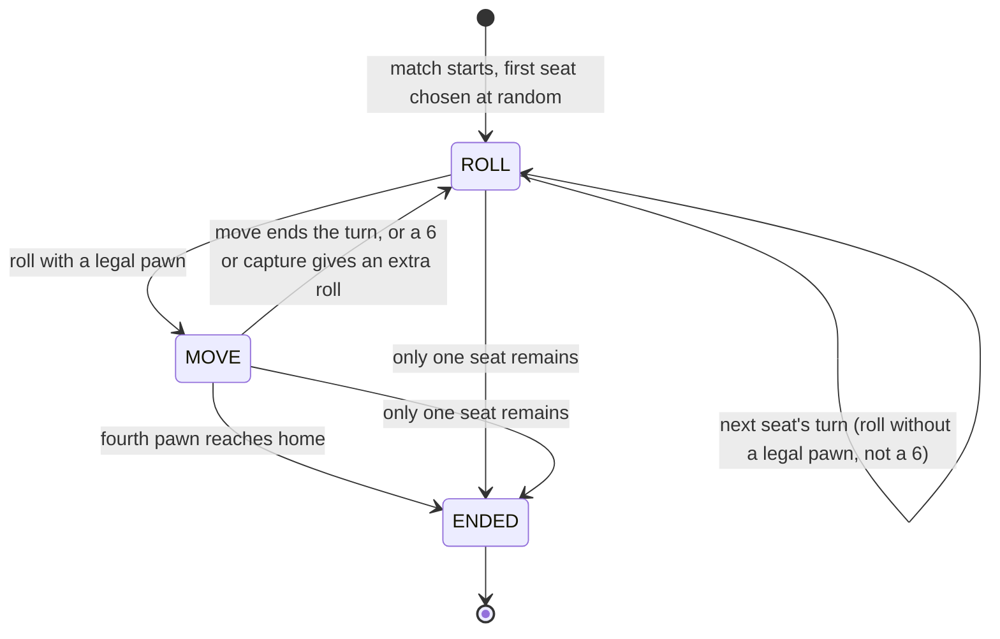

# Data Model: Ludo

Nothing here is stored beyond memory. A match lives in the server's memory with its room (online)
or in the visitor's own browser (solo). Wire shapes are in
[contracts/ludo-protocol.md](contracts/ludo-protocol.md) and
[contracts/game-channel.md](contracts/game-channel.md); this file defines the entities, their
rules and their state changes.

## Where each part lives

| Part | Location | Pure? |
|------|----------|-------|
| Rules engine, board geometry, computer strategies | `packages/ludo` | Yes: no time, no randomness, no DOM or Node APIs; dice and seeds are passed in |
| Online match runner (timers, away, publishing) | `apps/server/src/games/ludo` | No: uses the clock port and cryptographic dice |
| Projection per recipient | `apps/server/src/games/ludo/view.ts` | Yes |
| Rendering, solo runner, preferences | `apps/web/src/features/ludo` | No |

## Platform entities added (generic, no Ludo knowledge)

### Room (additions to 001)

| Field | Type | Rules |
|-------|------|-------|
| `matchId` | string or null | New UUID on each match start and rematch; null in the lobby |
| `gameSeq` | integer | 0 at match start; incremented by each publish; never reused within a `matchId` |

### GameChannelMessage (server to client)

`{ matchId, seq, state, events }` as in the game channel contract. Not stored.

## Ludo entities

### Colour and seat assignment

| Players | Colours used, in turn order |
|---------|----------------------------|
| 2 | Red, Yellow |
| 3 | Red, Green, Yellow |
| 4 | Red, Green, Yellow, Blue |

Online: people are assigned in the order they joined the room (the platform's participant
order at match start). Solo: the visitor is Red; computers take the remaining colours in turn
order (1 opponent: Yellow; 2: Green and Yellow; 3: Green, Yellow and Blue). Turn order is clockwise
Red, Green, Yellow, Blue, skipping unused colours. The first player is chosen at random by the
game.

### Board path (constants in `packages/ludo`)

| Name | Value |
|------|-------|
| `RING_LENGTH` | 52 |
| `START_INDEX` | Red 0, Green 13, Yellow 26, Blue 39 |
| `STAR_INDEXES` | 8, 21, 34, 47 |
| `LANE_LENGTH` | 5 (steps 51 to 55) |
| `HOME_STEP` | 56 |
| Protected squares | The four start squares and the four star squares |
| Layout table | A 15 by 15 grid position for every ring index, lane square and base slot, defined once and used by both renderers |

A unit test checks the table: 52 distinct ring squares, consecutive squares one grid step apart,
starts at the right indexes, four lanes of five squares meeting the centre.

### Pawn

| Field | Type | Rules |
|-------|------|-------|
| `step` | integer | -1 base, 0 start square, 1 to 50 ring, 51 to 55 lane, 56 home (see protocol section 4) |

A pawn belongs to one seat; each seat has exactly four, numbered 0 to 3.

### Seat

| Field | Type | Rules |
|-------|------|-------|
| `color` | RED, GREEN, YELLOW, BLUE | Unique within the match |
| `kind` | HUMAN or COMPUTER | Online seats are always HUMAN |
| `label` | string | Display label from the room; "Computer N" for computers |
| `participantId` | string, optional | Online human seats only; the key used to match actions to seats |
| `pawns` | four pawns | Empty when `left` |
| `away` | boolean | Set after 3 missed turns; cleared by `resume` |
| `missed` | integer 0 to 3 | Consecutive timeouts; reset by any manual action |
| `left` | boolean | True after the seat is released; never reversed |

### Turn

| Field | Type | Rules |
|-------|------|-------|
| `seat` | index or null | The seat that must act; null only after the match ends |
| `phase` | ROLL, MOVE, ENDED | See state changes |
| `dice` | 1 to 6 or null | Set only in MOVE |
| `sixesInRow` | 0 to 2 | Resets whenever the turn passes |

### Die roll (an event, not stored)

`{ seat, value, seed, durationMs }`. `value` and `seed` come only from the server's generator
(online) or the visitor's own generator (solo).

### Game log entry

`{ n, text, seat? }`. The last 50 are kept; the text is plain language and contains only labels
and numbers (no HTML).

### Theme (web data)

`{ id, name, description, palette, board, pawns, die, props, celebration }`. Only `id` is part of
the settings; everything else is presentation data in the web app.

### Visual quality, view (browser)

Per-device preferences, see the UI contract section 8. Never sent anywhere.

### Solo match (browser)

| Field | Type | Rules |
|-------|------|-------|
| `settings` | `{ theme, opponents, difficulty }` | Chosen in setup; fixed for the match |
| `state` | the engine state | Same shape as the online match, with COMPUTER seats |
| `savedAt` | epoch milliseconds | Updated on every state change; the match is discarded 30 minutes later |

### Catalog picture

An enum name (`LUDO`) on the catalog entry's `art`, mapped by the web app to one shipped file
(see research R14). Not user data.

## Rules and validation

1. **Roll** (phase ROLL, current seat): the value is supplied by the caller. If the seat has no
   legal pawn, the turn passes unless the value is 6 (then the same seat rolls again, subject
   to the three-6s rule); otherwise the phase becomes MOVE.
2. **Legal pawn** for roll `v`:
   - In base: only when `v = 6`; goes to step 0.
   - On the path: `step + v <= 56`; the destination must not be a block of another seat
     (blocks matter only on ring squares that are not protected).
   - Passing over a block is allowed.
   - At home (56): never moves.
3. **Move**: the pawn goes to its destination. If the destination is an unprotected ring square
   holding exactly one opponent pawn, that pawn returns to base and the mover rolls again.
   (A square with two or more pawns of the same opponent is a block, so a capture only ever
   involves one pawn.)
4. **Extra roll**: a 6, or a capture. Reaching home does not give an extra roll. A seat never
   gets more than the 6s limit: the third 6 in a row ends the turn with no move, and a 6 that
   cannot be used still gives its extra roll.
5. **Block**: two or more pawns of the same seat on the same ring square that is not protected.
   Own pawns may always join their own block. Lane squares are private to one colour, so they
   never form blocks.
6. **Win**: the first seat with four pawns on step 56 wins; the match ends at once.
7. **Seat leaves**: `left` becomes true, pawns are removed, and the turn passes if it was
   theirs. If exactly one seat has not left, that seat wins.
8. **Away and resume**: `missed` increases by one for each timeout; at 3, `away` is set.
   `resume` clears `away` and `missed`; so does any manual roll or move.
9. **Auto choice** (timeout and away): capture if any legal pawn captures, otherwise the legal
   pawn with the highest `step`, otherwise the lowest pawn index.

## State changes (engine phases)

The runner adds a settle window after each roll (`ROLL_ANIMATION_MS`) during which `move` is
refused and the decision timer for the move has not started.

## Computer strategies (`packages/ludo`)

All three only choose among legal pawns; they never see or alter a roll.

| Difficulty | Choice |
|------------|--------|
| Easy | Uniformly at random among legal pawns (from the caller's random source) |
| Normal | Highest score among legal pawns: capture +100, reaching home +80, leaving base +60, entering a home lane +40, landing on a protected square +25, forming a block on an unprotected square +10, plus 1 per step of progress |
| Hard | Normal score, minus 60 if the landing square is on the ring, unprotected, not a block of its own, and has an opponent pawn 1 to 6 steps behind it, plus 30 if the pawn being moved currently stands on such an exposed square |

Ties go to the pawn with the highest step, then the lowest index. The weights are fixed and
documented here so the strategy is predictable and testable. The runner adds the visible
"choosing" pause: 700 to 1500 ms (random from the visitor's generator), at most 3 s in total with
the move, not counting the roll animation.

## Client state (web)

| State | Source | Reset |
|-------|--------|-------|
| `game` in `RoomState` | `game` messages and `snapshot.game` | On `match.started`, `match.rematch`, `match.returnedToLobby`, and when `matchId` changes |
| Event queue | `events` of each message | When the page is hidden (not replayed on return) or the reduced-motion/effects setting is on (events become instant state changes) |
| Unread counts | Game log and chat length versus the last opened length | When the sheet is opened |
| Quality, view | Local preferences | Never reset automatically |

## Limits

| Item | Limit |
|------|-------|
| Seats | 2 to 4 |
| Pawns per seat | 4 |
| Log entries kept | 50 |
| Action payload | Within the 4 KB client frame limit; in practice under 100 bytes |
| View size | A few KB, sent in full per update |
| Match state in memory | Under about 10 KB per room, freed on `releaseMatch` |
| Solo save | Under about 10 KB in local storage |
