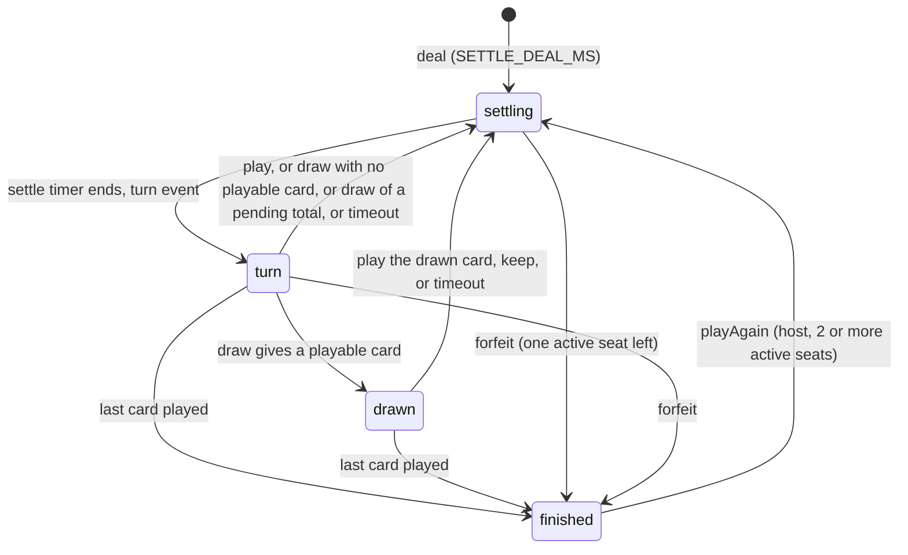

# Data Model: UNO Multi-Player & AI Game Module

All state is in memory for the life of a room (no database). The server owns the model below; `shared/src/uno/` holds the card table, constants and wire types that
server and client must agree on. Wire shapes are described again, with events and guarantees, in [contracts/uno-protocol.md](contracts/uno-protocol.md). Rules come from
the spec's Appendix A and the clarifications of 2026-11-05.

**Naming**: this document writes `cardOf` and unprefixed constants for readability. In code every export is prefixed (`unoCardOf`, `UNO_TURN_TIMER_MS`, `UNO_CATCH_WINDOW_MS`, `UnoTable` and so on)
because `shared/src/index.ts` re-exports each module with `export *` and Ludo already exports `TURN_TIMER_MS`, `AWAY_WARN_AT`, `AWAY_RELEASE_AT`, `BOT_PAUSE_MS` and `BOT_THINK_MS`.

## 1. Cards and the deck (`shared/src/uno/cards.ts`)

```ts
export type UnoColor = 'red' | 'yellow' | 'green' | 'blue';
export type UnoKind = 'number' | 'skip' | 'reverse' | 'draw2' | 'wild' | 'wild4';

export interface UnoCard {
  id: number;                 // 0..107
  color: UnoColor | null;     // null for wild and wild4
  kind: UnoKind;
  rank: number | null;        // 0..9 for 'number', otherwise null
}
export function cardOf(id: number): UnoCard;      // pure table lookup built once
export const UNO_COLORS: readonly UnoColor[];     // ['red', 'yellow', 'green', 'blue']
```

| Id range | Card | Count |
|----------|------|-------|
| `25c + 0` (c = 0 red, 1 yellow, 2 green, 3 blue) | Number 0 in colour c | 4 |
| `25c + 1 .. 25c + 18` | Numbers 1 to 9, two of each: id = `25c + 1 + 2(n - 1) + copy` (copy 0 or 1) | 72 |
| `25c + 19, 25c + 20` | Skip | 8 |
| `25c + 21, 25c + 22` | Reverse | 8 |
| `25c + 23, 25c + 24` | Draw 2 | 8 |
| `100 .. 103` | Wild | 4 |
| `104 .. 107` | Wild Draw 4 | 4 |

Total 108. `cardOf` throws for ids outside 0 to 107; the server treats such an id in an action as invalid before the lookup.

## 2. Constants (`shared/src/uno/timing.ts`)

| Constant | Value | Used by |
|----------|-------|---------|
| `UNO_HAND_SIZE` | 7 | deal (FR-011) |
| `UNO_MIN_PLAYERS`, `UNO_MAX_PLAYERS`, `UNO_DEFAULT_CAPACITY` | 2, 5, 4 | `games.ts` (FR-005) |
| `TURN_TIMER_MS` | 30 000 | human countdown (FR-022) |
| `AWAY_WARN_AT`, `AWAY_RELEASE_AT` | 2, 3 | missed turns in a row (FR-022) |
| `CATCH_WINDOW_MS`, `CATCH_PENALTY` | 5 000, 2 | UNO! catch (FR-039, FR-040) |
| `BOT_PAUSE_MIN_MS`, `BOT_PAUSE_MAX_MS` | 1 500, 2 000 | bot pause before acting (FR-043) |
| `BOT_CATCH_MIN_MS`, `BOT_CATCH_MAX_MS` | 2 000, 3 500 | bot catch reaction (FR-044) |
| `BOT_FORGET_PROBABILITY` | 1/6 | bot forgets UNO! (FR-044) |
| `THROW_MS`, `FLY_MS`, `FLY_STAGGER_MS`, `FLY_MAX_MS` | 450, 400, 110, 1 200 | animations and settle times |
| `BOUNCE_MS`, `SHAKE_MS`, `FLARE_MS`, `AURA_MS`, `BANNER_MS` | 320, 240, 600, 350, 900 | client effects |
| `SETTLE_DEAL_MS`, `SETTLE_PLAY_MS`, `SETTLE_EFFECT_MS` | 1 500, 600, 900 | server pause before the next turn starts |
| `PENALTY_BEAT_MS` | 900 | pause before an unavoidable penalty is taken for a human player (a bot waits its normal pause) |

## 3. Server model (`server/src/games/uno/model.ts`)

```ts
interface Seat {
  playerId: string;
  name: string;
  kind: 'human' | 'bot';
  slot: number;                // 0 = host seat, in slot order
  hand: number[];              // card ids; private
  status: 'active' | 'left';
  calledUno: boolean;
  missed: number;              // consecutive missed turns
  warned: boolean;             // two misses reached (shows the warning)
}

interface Match {
  ctx: GameContext;
  seats: Seat[];               // slot order; left seats stay in the list
  matchNo: number;             // 1 for the first deal, +1 on each Play again
  dealer: number;              // index into seats
  drawPile: number[];          // top = last element; never sent
  discard: number[];           // top = last element
  turn: string | null;         // playerId whose turn it is (or will be once settled)
  direction: 1 | -1;           // +1 = seat order (clockwise on screen), -1 = reverse
  activeColor: UnoColor;
  pending: { kind: 'draw2' | 'wild4'; total: number } | null;
  phase: 'settling' | 'turn' | 'drawn' | 'finished';
  drawn: { playerId: string; card: number } | null;   // the playable card just drawn
  catchWindow: { victim: string; closesAt: number; cancel: () => void } | null;
  deadline: number | null;     // ctx.now() epoch when the human countdown ends
  thinking: string | null;     // bot playerId during its pause
  seq: number;                 // last event sequence
  timers: Set<() => void>;     // cancel functions for every pending ctx.schedule
  releasing: Map<string, 'inactive'>;
  disposed: boolean;
}
```

Invariants: every card id appears exactly once across all hands, the draw pile, the discard pile and (momentarily) a `drawn` slot; `turn` is null only when `phase` is
`finished`; `pending` is non-null only when `turn` is the target of a Draw 2 or Wild Draw 4; at most one catch window is open.

## 4. Wire types (`shared/src/uno/types.ts`)

```ts
interface UnoSeatView {
  playerId: string; slot: number; name: string;
  kind: 'human' | 'bot'; status: 'active' | 'left';
  handCount: number; calledUno: boolean; warned: boolean;
}
interface UnoStanding { playerId: string; name: string; place: number; cardsLeft: number | null; status: 'active' | 'left' }

/** Public: identical for every viewer. */
interface UnoTable {
  matchNo: number;
  phase: 'settling' | 'turn' | 'drawn' | 'finished';
  turn: string | null;
  direction: 1 | -1;
  activeColor: UnoColor;
  top: number;                           // card id on top of the Discard Pile
  drawCount: number; discardCount: number;
  pending: { kind: 'draw2' | 'wild4'; total: number } | null;
  catchWindow: { victim: string; remainingMs: number } | null;
  remainingMs: number | null;            // human countdown, null for bots, settling and finished
  thinking: string | null;
  players: UnoSeatView[];                // slot order
  winner: string | null;
  standings: UnoStanding[] | null;       // set when finished
}

/** Private: only the viewer's own copy carries it. */
interface UnoYou {
  playerId: string;
  hand: number[];                        // unsorted; the client sorts for display
  playable: number[];                    // ids the viewer may play right now (empty when not their turn or not 'turn'/'drawn')
  drawn: number | null;                  // the card they just drew and may play or keep
  canDraw: boolean;                      // their turn, phase 'turn', and nothing else blocks it
  canKeep: boolean;                      // phase 'drawn' for them
  canCallUno: boolean;                   // exactly 2 cards, or a catch window is open against them
  unoCalled: boolean;                    // their calledUno flag (drives the button state)
}

interface UnoView { seq: number; table: UnoTable; you: UnoYou | null }   // null for a viewer who is not seated
```

Size: `table` about 600 bytes and `you` about 200 bytes for a 5-player match; every event stays under 2 KB.

## 5. Rules tables

### Playability for the player whose turn it is

| Order | Condition | Playable cards |
|-------|-----------|----------------|
| 1 | `phase = 'drawn'` | Only `drawn.card` (or `keep`) |
| 2 | `pending` is set | Draw 2 when `pending.kind = 'draw2'`; Wild Draw 4 when `pending.kind = 'wild4'`; nothing else. Drawing takes the whole total |
| 3 | otherwise | Any Wild or Wild Draw 4; a coloured card whose colour equals `activeColor`; a number card whose number equals the top card's number; a Skip, Reverse or Draw 2 when the top card has the same kind |

`activeColor` is the top card's colour, or the colour chosen for the Wild that is on top. A top Wild has no number or kind, so only the chosen colour (or another Wild) matches.

### Effects after a legal play

| Card | Effect on `turn`, `direction`, `pending`, `activeColor` |
|------|----------------------------------------------------------|
| Number | Advance to the next active seat; `activeColor` = card colour |
| Skip | `activeColor` = card colour; advance two active seats; the skipped player is named in the event |
| Reverse | `activeColor` = card colour; flip `direction`; advance one active seat in the new direction, or the same player again when exactly 2 seats are active |
| Draw 2 | `activeColor` = card colour; `pending.total += 2` (kind `draw2`); advance one active seat |
| Wild | `activeColor` = chosen colour; advance one active seat |
| Wild Draw 4 | `activeColor` = chosen colour; `pending.total += 4` (kind `wild4`); advance one active seat |

A Draw 2 can be stacked only on a pending `draw2` and a Wild Draw 4 only on a pending `wild4`. When the next player cannot stack, the server takes the pending total for them after
`PENALTY_BEAT_MS` (a bot waits its normal pause); they lose their turn and `pending` clears. If the draw pile cannot supply the full amount even after a reshuffle, the player draws what exists.

### Starting card (FR-019)

Deal 7 cards each round-robin from slot order, then turn cards until one is not a Wild or Wild Draw 4 (rejected cards go back into the pile, which is reshuffled). The first player is
active seat `(matchNo - 1) mod n`; the dealer is the seat before it. Then, as if the dealer had played the card: number, nothing; Skip, the first player is skipped; Reverse, the direction
flips and play starts with the dealer's next seat in the new direction (with 2 active seats the dealer goes first); Draw 2, the first player draws 2 at once with no stacking option and
loses the turn.

## 6. State machines

### Match phases



`UNO!` and `Catch` are accepted in every phase except `finished`; `playCard`, `drawCard` and `keepCard` only in `turn` or `drawn` by the player whose turn it is.

### UNO! and the catch window (FR-037 to FR-041)

| Event | Seat effect | Catch window |
|-------|-------------|--------------|
| `callUno` with exactly 2 cards | `calledUno = true`; `uno` event | none |
| `callUno` during a window against the caller | `calledUno = true`; `uno` event | closes (safe) |
| `callUno` otherwise | rejected "Not yet" | unchanged |
| Play leaves 1 card and `calledUno` is true | nothing | none |
| Play leaves 1 card and `calledUno` is false | nothing yet | opens for `CATCH_WINDOW_MS`; `catchOpen` event |
| `catchPlayer` by another player while open | victim draws `CATCH_PENALTY`; `calledUno = false`; `caught` and `draw` events | closes |
| `catchPlayer` otherwise (closed, victim called, self, wrong player) | rejected "Too late" or "You cannot catch yourself" | unchanged |
| Window expires | none | closes (`catchClosed`, reason `expired`) |
| Victim's hand grows (an opponent's penalty reaches them), victim leaves, match finishes | `calledUno` cleared when the hand exceeds 2 | closes |
| Any change that leaves a seat with more than 2 cards | `calledUno = false` | not applicable |

### Seat status

`active` to `left` on release (left, disconnected past the reconnect window, removed, or three missed turns). A `left` seat holds no cards, is skipped and cannot return to that match.
`playAgain` keeps only seats that are still `active` and discards `left` seats from the new match.

## 7. Standings (FR-049)

`place 1` is the winner; every other active seat follows by fewest cards left, ties broken by slot order; `left` seats come last with `cardsLeft: null`. A forfeit winner is the last
active seat with `cardsLeft` as held.

## 8. Requirement to rule map

| Requirement | Enforced by |
|-------------|-------------|
| FR-011, FR-018, FR-019 | `deck.ts` (build, shuffle, deal, reshuffle), `rules.ts` start card |
| FR-012, FR-014 | `engine.onAction` schema and checks, `matchOps` phase gating |
| FR-013, FR-015, FR-017 | `rules.ts` playable and effects |
| FR-016 | `matchOps.drawCard`, `keepCard`, phase `drawn` |
| FR-020 | `matchOps.afterPlay` (hand empty) and `finish` |
| FR-021 | `viewFor` builds `table` and `you`; no other builder exists |
| FR-022 | `startTurn` countdown, `onTimeout`, `ctx.releaseSeat` |
| FR-037 to FR-041 | `callUno`, `catchPlayer`, `openCatchWindow` |
| FR-042 to FR-045 | `bot.ts` + the same `playCard`, `drawCard`, `keepCard`, `callUno`, `catchPlayer` functions |
| FR-050 | `again` in `engine.ts` (host check via `ctx.hostId()`) |
| FR-051 to FR-053 | `engine.onSeatReleased`, `getView` |

## 9. Development-only deals (`deck.ts`, ignored in production)

| `UNO_DEV_DECK` | Intent | Fixed conditions |
|----------------|--------|------------------|
| `wild` | Play a Wild and a Wild Draw 4 | Seat 0 holds a Wild, a Wild Draw 4 and five cards that match the starting card; the starting card is red 5 |
| `reverse` | Play a Reverse | Seat 0 holds a red Reverse among playable red cards; the starting card is red 5 |
| `uno` | Reach one card | Seat 0 holds exactly two cards that match the starting card (so one play leaves one card); other seats random |
| `stack` | Stack Draw 2 and Wild Draw 4 | Seats 0 and 1 each hold a red Draw 2 and a Wild Draw 4; seat 2 and later hold neither; the starting card is red 5 |
| `short-pile` | Force a reshuffle | After the deal the Draw Pile holds 4 cards and the Discard Pile holds a further 20 below the top card |
| `endgame` | Win quickly | Seat 0 holds one card that matches the starting card |

Every other seat's hand and the rest of the pile are random unless a scenario fixes them. Scenario data lives in `deck.ts`; clients can neither name nor influence a scenario.

## 10. Platform-level data changes

| Where | Change |
|-------|--------|
| `GameDefinition` (`shared/src/games.ts`) | New optional `launch?: { askCapacity?: boolean; startAiAtOnce?: boolean; hostFillWithAi?: boolean }`; the `uno` entry sets all three |
| `CreateRoomPayload` (`shared/src/protocol.ts`) | New optional `capacity?: number` |
| `EVENTS` | New `ROOM_FILL_AI: 'room:fillAi'` |
| `room:create` schema | `botCount` maximum 3 to 4; new optional `capacity` (integer) |
| `Room` | New `startNow()` and `fillWithBots(socketId)`; bot names continue across calls |

The `uno` game entry: `id: 'uno'`, `name: 'UNO'`, `status: 'active'`, `minPlayers: 2`, `maxPlayers: 5`, `defaultCapacity: 4`, `supportsAi: true`, `quietChat: true`, not `roster`,
`seatColors: ['orange', 'purple', 'teal', 'pink', 'lime']`, theme `{ accent: '#ffcf3d', accent2: '#ff4d6d' }`.
